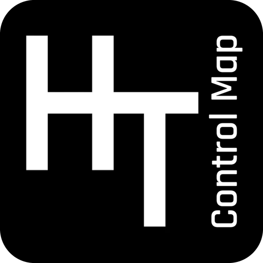
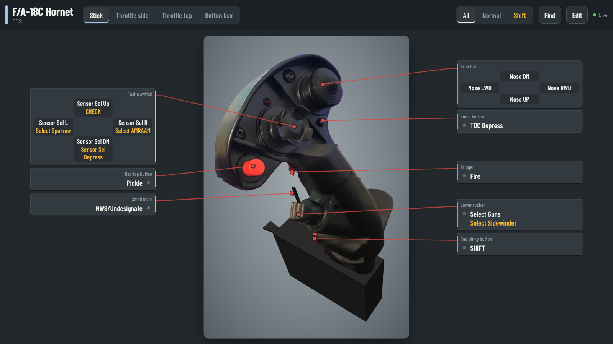
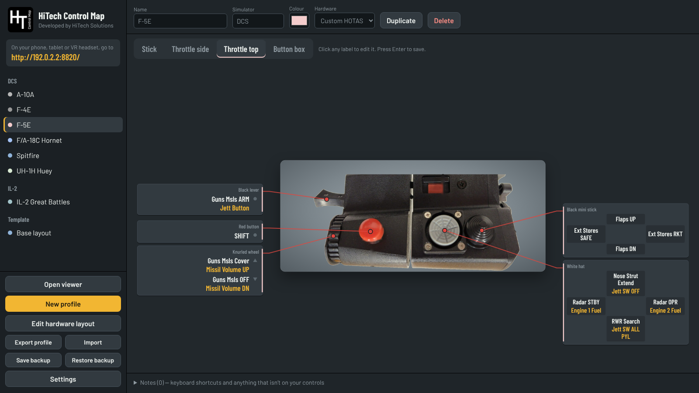
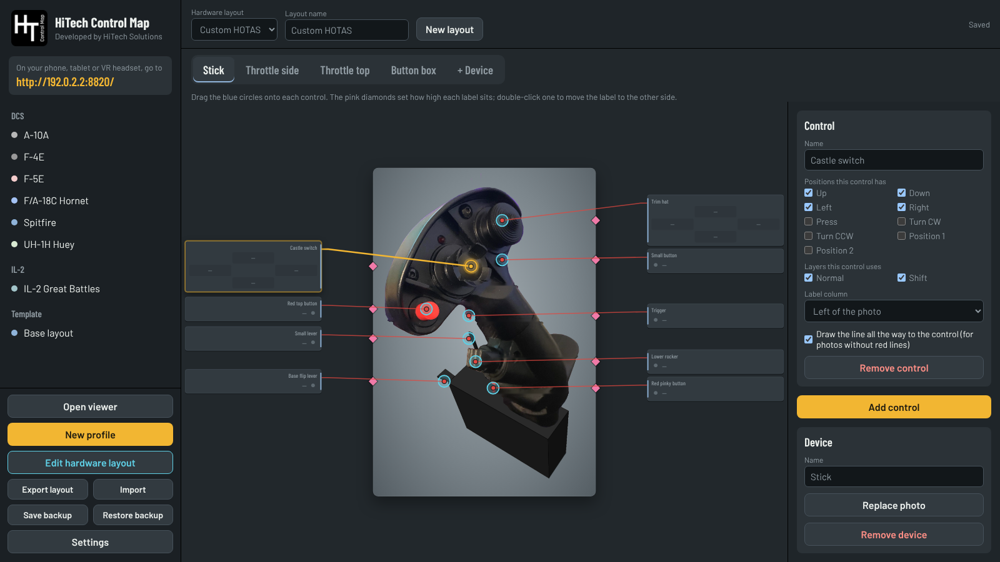

<p align="center"></p>

<h1 align="center">HiTech Control Map</h1>

<p align="center">A reference card for your HOTAS, button box and gamepad.<br>
Every button, hat and switch labelled on a photo of your own hardware, one profile per aircraft.</p>

<p align="center"><b><a href="https://github.com/ht-hitechsolutions/hitech-control-map/releases/latest">⬇ Download for Windows</a></b></p>



## What it does

- **Your hardware, your photos.** Add a photo of each device (stick, throttle, button box, pedals, gamepad), place a marker on every control, and the labels are drawn around it. Works with any brand, including home-built hardware.
- **One profile per aircraft.** Shift functions show in yellow next to the normal ones, so you see both at a glance.
- **Find any function.** Search "flaps" and it jumps to the right button.
- **Quick to edit.** Click any label and type. Every open screen updates within a second.
- **Share profiles.** Export an aircraft with its hardware layout and photos as one file. Others import it without overwriting their own.
- **Any sim.** MSFS 2020/2024, DCS, IL-2, X-Plane or anything else, since it doesn't connect to the sim.
- **Phone, tablet and VR.** Any device with a browser on your home network can open it, including VR headsets like the Meta Quest.
- Step-by-step tutorial on first launch, plus an optional edit PIN for when other devices connect.

| Editing bindings | Setting up your hardware |
|---|---|
|  |  |

## Get started

1. Download the latest `HiTech-Control-Map-…-Windows.zip` from [Releases](https://github.com/ht-hitechsolutions/hitech-control-map/releases/latest) and unzip it anywhere.
2. Run **HiTech Control Map.exe**. Windows SmartScreen may warn because the program isn't code-signed: click *More info → Run anyway*.
3. The editor opens in your browser. Start with your own controls or explore the example setup; a short tutorial walks you through it.
4. Click **Open viewer** to see your bindings, for example on a second monitor.
5. On a phone, tablet or VR headset, open the address shown in the editor (like `http://192.168.0.15:8787/`) and bookmark it. If it doesn't load, use *Settings → Allow on my network*.

Keep the small console window open while you use it. Your profiles are saved in the `Control Map Data` folder next to the program.

## Troubleshooting

- **A phone or headset can't open the page:** check the app is running, the address matches the editor's, and use *Settings → Allow on my network*. Guest Wi-Fi networks often block devices from seeing each other.
- **The address changed:** routers can give the PC a new address. Reserving a fixed IP for the PC in your router stops that.

## Building from source

Requires [Go](https://go.dev) 1.22 or newer. The web pages, fonts and example are built into the program.

```
cd server
go build -o "HiTech Control Map.exe" .
```

`tools/make_icons.py` rebuilds the icons from `tools/logo-source.png`.

## Credits

Developed by **HiTech Solutions**. Barlow fonts by Jeremy Tribby (SIL Open Font License 1.1).
